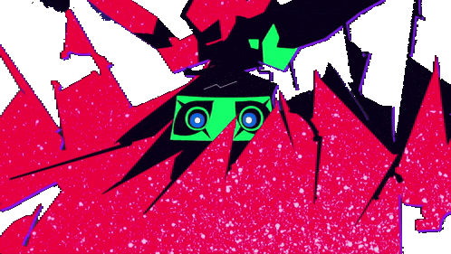

<p align="center">
  
</p>

<p align="center">
  
</p>

<h1 align="center">▓▒░ ALEXANDRE SANTOS ░▒▓</h1>

<p align="center">
  <code>RESEARCHER @ LAQCC</code> ⟨◆⟩ <code>QUANTUM COMPUTING</code> ⟨◆⟩ <code>ARTIFICIAL INTELLIGENCE</code>
</p>

<p align="center">
  <a href="mailto:alexandreoliversan1@gmail.com"></a>
  <a href="https://www.linkedin.com/in/alexandre-oliveira-a529a1241"></a>
  <a href="https://github.com/nakka1"></a>
  <a href="http://lattes.cnpq.br/5517445455728374"></a>
</p>

<p align="center"></p>
<p align="center"></p>

```console
nakka1@laqcc:~$ whoami
```

I'm a Computer Engineering undergraduate and a researcher at the **Latin America Quantum Computing Center (LAQCC)**, SENAI CIMATEC, since 2024. I work where **AI and quantum computing** meet:

- `▸` **Quantum networks**: network control, entanglement distillation, repeaters and QKD
- `▸` **Machine learning for quantum systems**: reinforcement learning for routing and control, attack detection in QKD
- `▸` **Artificial Intelligence**: generalization under noise and data scarcity, quantized models, local/neuromorphic learning and on-device LLM inference
- `▸` **GPU-accelerated quantum simulation** with CUDA-Q and C++ for supercomputers
- `▸` **Academic research**, with an accepted journal paper and talks at symposia and conferences

> `[!]` Part of my LAQCC work lives in private repositories; my public projects are listed below.

<p align="center"></p>
<p align="center"></p>

```console
nakka1@laqcc:~$ cat sobre_mim.txt
```

Sou estudante de Engenharia da Computação e pesquisador no **Latin America Quantum Computing Center (LAQCC)**, SENAI CIMATEC, desde 2024. Meu foco é a interseção entre **IA e computação quântica**:

- `▸` **Redes quânticas**: controle de redes, destilação de emaranhamento, repetidores e QKD
- `▸` **Machine learning para sistemas quânticos**: aprendizado por reforço para roteamento e controle, detecção de ataques em QKD
- `▸` **Inteligência Artificial**: generalização sob ruído e escassez de dados, modelos quantizados, aprendizado local/neuromórfico e inferência local de LLMs
- `▸` **Simulação quântica** em GPU com CUDA-Q e C++ para supercomputadores
- `▸` **Pesquisa acadêmica**, com artigo aceito e apresentações em simpósios e congressos

> `[!]` Parte do meu trabalho no LAQCC fica em repositórios privados; meus projetos públicos estão abaixo.

<p align="center"></p>

<p align="center"></p>

| `>_` Project | `>_` Description |
| --- | --- |
| [**ORION-Q**](https://github.com/nakka1/Orion-Q)<br>`[ PUBLIC ]` | Research platform for quantum-network control (my undergraduate thesis), with entanglement, BBPSSW purification, TF-QKD, satellite links and optional ML controllers. |
| [**Nano Qalgos**](https://github.com/nakka1/nano-qalgos)<br>`[ PUBLIC ]` | Quantum algorithms from scratch in one NumPy file: QFT, phase estimation, Grover, Shor, VQE, QAOA and amplitude estimation. Every equation sits next to the code that implements it and is checked numerically. |
| **Nano QEC**<br>`[ IN DEVELOPMENT ]` | Quantum error correction from scratch in one NumPy file: state vectors, Pauli algebra, repetition, Steane and surface codes, a decoder, and the exact logical error rate as a polynomial. No black boxes, no quantum SDK, runs in your browser. |
| **E.V.A.**<br>`[ IN DEVELOPMENT ]` | Local-first AI assistant with on-device inference and a custom wearable, independent of third-party APIs. |

<p align="center"></p>

<p align="center"></p>

```yaml
# ~/.config/nakka1/arsenal.yml

Languages:
  [Python, C++, C, JavaScript, Bash, Markdown]

Quantum:
  [Qiskit, Qiskit Aer, CUDA-Q, Qiskit Metal, PennyLane, SeQUeNCe, IBM Quantum]

AI / ML:
  [PyTorch, JAX, TensorFlow, scikit-learn, Reinforcement Learning,
   Quantum Autoencoders, Hybrid Classical-Quantum Optimization]

Tools:
  [Linux, Git, GitHub, LaTeX, OpenCV, ROS, Arduino, CUDA, Qt]

Cloud:
  [Google Cloud, Google Colab, AWS]
```

<p align="center"></p>

<p align="center"></p>

`[ PAPER ]` Accepted paper in *Revista Brasileira de Ensino de Física* (tutorial on the HHL quantum algorithm)  
`[  LAB  ]` Researcher at LAQCC / QuIIN – SENAI CIMATEC since 2024  
`[ TALKS ]` Technical presentations on Majorana qubits, quantum data compression, GPU quantum simulation, quantum machine learning and robotics  
`[ LEARN ]` Workshops attended with companies such as Womanium, IBM Quantum, NVIDIA and QuEra  
`[  QPU  ]` Experience with real IBM quantum hardware and classical optimization algorithms coupled with quantum circuits  

<p align="center"></p>

<p align="center"></p>

<p align="left"> <a href="https://www.arduino.cc/" target="_blank" rel="noreferrer">  </a> <a href="https://aws.amazon.com" target="_blank" rel="noreferrer">  </a> <a href="https://www.gnu.org/software/bash/" target="_blank" rel="noreferrer">  </a> <a href="https://www.cprogramming.com/" target="_blank" rel="noreferrer">  </a> <a href="https://www.w3schools.com/cpp/" target="_blank" rel="noreferrer">  </a> <a href="https://www.w3schools.com/css/" target="_blank" rel="noreferrer">  </a> <a href="https://cloud.google.com" target="_blank" rel="noreferrer">  </a> <a href="https://git-scm.com/" target="_blank" rel="noreferrer">  </a> <a href="https://www.w3.org/html/" target="_blank" rel="noreferrer">  </a> <a href="https://www.linux.org/" target="_blank" rel="noreferrer">  </a> <a href="https://www.mathworks.com/" target="_blank" rel="noreferrer">  </a> <a href="https://opencv.org/" target="_blank" rel="noreferrer">  </a> <a href="https://pandas.pydata.org/" target="_blank" rel="noreferrer">  </a> <a href="https://www.python.org" target="_blank" rel="noreferrer">  </a> <a href="https://pytorch.org/" target="_blank" rel="noreferrer">  </a> <a href="https://scikit-learn.org/" target="_blank" rel="noreferrer">  </a> <a href="https://seaborn.pydata.org/" target="_blank" rel="noreferrer">  </a> <a href="https://www.tensorflow.org" target="_blank" rel="noreferrer">  </a> </p>

<p align="center"></p>

<p align="center"></p>
